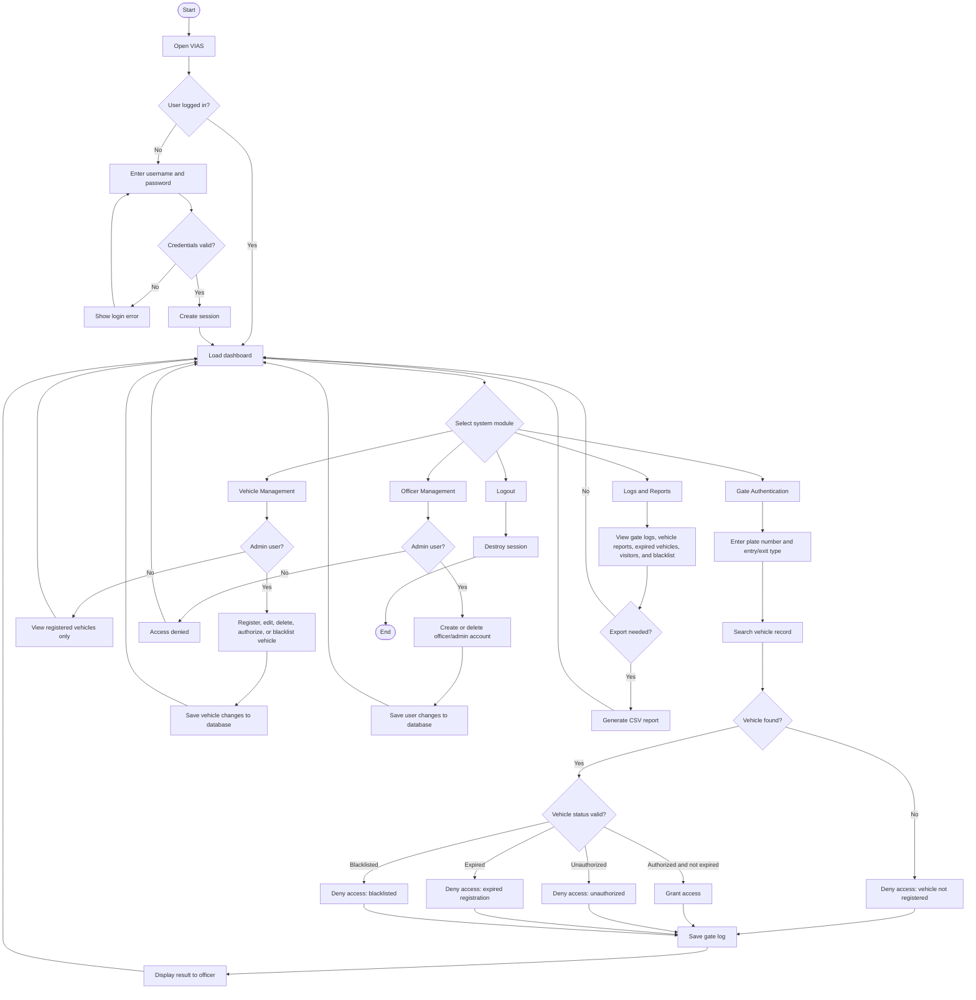
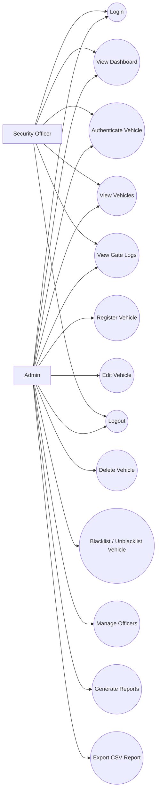

# VIAS Flowchart and Use Case

## System Flowchart

## Use Case Diagram

## Main Actors

| Actor | Description |
| --- | --- |
| Admin | Full system user who manages vehicles, officers, logs, reports, and vehicle authentication. |
| Security Officer | Gate user who verifies vehicles, views registered vehicles, checks logs, and records entry or exit activity. |

## Use Case Descriptions

### 1. Login

| Item | Description |
| --- | --- |
| Use Case | Login |
| Actors | Admin, Security Officer |
| Goal | Allow authorized users to access the VIAS system. |
| Precondition | The user account exists in the database. |
| Main Flow | User enters username and password. The system verifies the details. If valid, the system creates a session and opens the dashboard. |
| Alternative Flow | If the credentials are invalid, the system displays an error and asks the user to try again. |
| Postcondition | The user is authenticated and can access role-based modules. |

### 2. Authenticate Vehicle

| Item | Description |
| --- | --- |
| Use Case | Authenticate Vehicle |
| Actors | Admin, Security Officer |
| Goal | Verify whether a vehicle should be granted or denied campus access. |
| Precondition | The user is logged in. |
| Main Flow | User enters the vehicle plate number and selects entry or exit. The system searches the vehicle record. The system checks vehicle status and expiry date. Access is granted if the vehicle is authorized and valid. The attempt is saved in the gate logs. |
| Alternative Flow | If the vehicle is not registered, expired, unauthorized, or blacklisted, the system denies access and records the reason. |
| Postcondition | A gate log is created with the plate number, officer, result, reason, and timestamp. |

### 3. Register Vehicle

| Item | Description |
| --- | --- |
| Use Case | Register Vehicle |
| Actor | Admin |
| Goal | Add a new vehicle record to the system. |
| Precondition | Admin is logged in. |
| Main Flow | Admin enters owner details, plate number, department, phone number, vehicle type, color, category, valid-until date, status, and vehicle image. The system validates and saves the record. |
| Alternative Flow | If the plate number already exists or required fields are missing, the system prevents saving until corrected. |
| Postcondition | The vehicle is stored in the database and becomes available for authentication. |

### 4. Manage Vehicle

| Item | Description |
| --- | --- |
| Use Case | Manage Vehicle |
| Actor | Admin |
| Goal | Update, delete, authorize, unauthorize, blacklist, or unblacklist vehicle records. |
| Precondition | Admin is logged in and the vehicle exists. |
| Main Flow | Admin opens the vehicles module, selects a vehicle, and performs the required action. The system saves the update to the database. |
| Alternative Flow | If the vehicle cannot be found, the system displays an error or returns to the vehicle list. |
| Postcondition | The vehicle record reflects the latest admin action. |

### 5. View Vehicles

| Item | Description |
| --- | --- |
| Use Case | View Vehicles |
| Actors | Admin, Security Officer |
| Goal | View registered vehicles and their current access status. |
| Precondition | User is logged in. |
| Main Flow | User opens the vehicles module. The system displays vehicle records, owner details, categories, validity dates, and status. |
| Postcondition | User can inspect vehicle information. |

### 6. View Gate Logs

| Item | Description |
| --- | --- |
| Use Case | View Gate Logs |
| Actors | Admin, Security Officer |
| Goal | Review vehicle entry and exit authentication history. |
| Precondition | User is logged in. |
| Main Flow | User opens the logs module. The system displays plate number, entry/exit type, officer username, result, reason, and timestamp. |
| Postcondition | User can audit gate activity. |

### 7. Manage Officers

| Item | Description |
| --- | --- |
| Use Case | Manage Officers |
| Actor | Admin |
| Goal | Create or remove admin and officer accounts. |
| Precondition | Admin is logged in. |
| Main Flow | Admin opens the officers module, enters account details, assigns a role, and saves the account. Admin can also delete existing accounts. |
| Alternative Flow | If username already exists or required fields are missing, the system rejects the action until corrected. |
| Postcondition | User account records are updated in the database. |

### 8. Generate Reports

| Item | Description |
| --- | --- |
| Use Case | Generate Reports |
| Actor | Admin |
| Goal | Produce reports about vehicles and gate activity. |
| Precondition | Admin is logged in. |
| Main Flow | Admin opens reports, selects the needed report category, and views the generated results. Available reports include vehicles, visitors, blacklisted vehicles, expired vehicles, and gate activity. |
| Alternative Flow | Admin may export report data as CSV. |
| Postcondition | The selected report is displayed or exported. |

### 9. Logout

| Item | Description |
| --- | --- |
| Use Case | Logout |
| Actors | Admin, Security Officer |
| Goal | End the current user session. |
| Precondition | User is logged in. |
| Main Flow | User clicks logout. The system destroys the session and redirects to the login page. |
| Postcondition | User must log in again to access protected modules. |

## Access Control Summary

| Feature | Admin | Security Officer |
| --- | --- | --- |
| Login | Yes | Yes |
| View dashboard | Yes | Yes |
| Authenticate vehicle | Yes | Yes |
| View vehicles | Yes | Yes |
| Register vehicle | Yes | No |
| Edit vehicle | Yes | No |
| Delete vehicle | Yes | No |
| Blacklist/unblacklist vehicle | Yes | No |
| View logs | Yes | Yes |
| Manage officers | Yes | No |
| Generate reports | Yes | No |
| Export reports | Yes | No |
| Logout | Yes | Yes |
